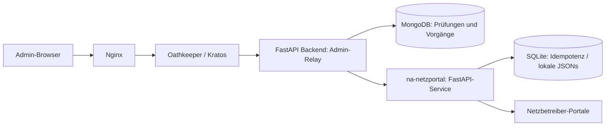

# auto-registry – Analyse und Integration

Stand: 4. November 2026. Branch: `auto-registry`.

## Analyse des bestehenden Projekts

- Vue 3/Vite mit getrennten Admin-/Installateuransichten. Das gemeinsame `FormCustomer.vue` erfasst Kundendaten und anlagetypabhängige Komponenten; der bisherige JSON-Export liefert bereits viele Anmeldedaten.
- FastAPI mit Motor/MongoDB. Anlagen sind Arrays im Kundendokument, derzeit ohne stabile eigene IDs; die API verwendet deshalb Kunden-ID plus Arrayindex. Firmen werden separat referenziert. Änderungen ersetzen teilweise das gesamte Anlagenarray.
- Nginx ist der öffentliche Einstiegspunkt; Kratos verwaltet Identitäten mit Schema `admin` oder `installer`, Oathkeeper prüft Sessions und setzt Identitätsheader. Das Backend hat keinen Host-Port.
- Die bisherige `_admin_identity` prüfte nur das Vorhandensein einer ID. Sie verlangt jetzt zusätzlich das Schema `admin`. Der neue Relay nutzt diese Prüfung auf jeder Route. Nginx entfernt eingehende Identitätsheader vor Oathkeeper. Andere bestehende Authentifizierungsrouten wurden nicht vollständig auditiert.
- Ein separater interner PDF-Service existierte bereits. Der Netzportal-Service folgt diesem Muster, erhält aber ein eigenes Netz, einen Bearer-Schlüssel und ein persistentes Journal.

## Architektur



Nur Backend und Netzportal-Service sind Mitglieder von `na-netzportal-relay`. Der Service hat weder Host-Port noch Nginx-Route. Das Bridge-Netz ermöglicht ausgehenden Internetzugang für die Portallogins. Die Zugangsdaten liegen ausschließlich beim Service. Der Browser erhält weder Portalpasswörter noch den Service-Bearer. Es gibt keinen frei konfigurierbaren URL-/Methoden-Proxy.

Das Backend vertraut ausschließlich Identitätsheadern des internen Oathkeeper-Pfads. Backend-Ports dürfen nicht extern veröffentlicht und direkte Backendaufrufe aus unkontrollierten Netzen nicht zugelassen werden. Ein Browser-Element allein ist keine Berechtigungsprüfung: Installateur-Schema und fehlende Identität werden serverseitig abgewiesen.

## Admin-Ablauf

Unter **Kunden & Anlagen → Kunde bearbeiten → Anlagen → Anlage öffnen**, im eigenen Tab **Netzanmeldung**. Der Tab ist ausschließlich für Admins bei PV-Anlagen ab `status=in_pruefung` verfügbar, einschließlich `angemeldet` und `abgeschlossen`. Bei ungespeicherten Änderungen zuerst speichern und die Anlage erneut öffnen:

1. Der Netzbetreiber wird automatisch aus der gespeicherten Anlagenadresse über VNBdigital ermittelt (Strom/Niederspannung). Bei abweichender Anlagenadresse wird diese verwendet. Mehrdeutige, fehlende oder noch nicht angebundene Betreiber sperren den Ablauf. Es gibt keine freie Betreiberauswahl. [Analyse und Suchprotokoll](../netzportal/docs/VNBDIGITAL.md).
2. Gespeicherte Daten zur Prüfung laden. Angezeigt werden Betreiber, ausgewählte Anlage, referenzierte Installateurfirma und Änderungsstand. Der Server liefert einen Hash dieser Vorschau.
3. Daten und angezeigten Funktionsumfang bestätigen, Prüfvermerk eingeben und **Prüfung speichern**. Der Server prüft, ob die Vorschau weiterhin aktuell ist. Allein die Prüfung löst keinen Portalaufruf aus.
4. **Lokale Vorbereitung starten** bzw. **Portalentwurf anlegen**. Der auslösende Admin muss selbst geprüft haben; die Freigabe gilt 30 Minuten. Vor dem Start werden Kunde, Anlage und Firma erneut geladen und mit dem geprüften Stand verglichen.
5. Ergebnis bzw. offene Vorgänge anzeigen. Ein Entwurf setzt den bisherigen Anlagenstatus nicht auf „angemeldet“.

Beim Erstellen speichert das Backend einen unveränderlichen Snapshot, Prüfvermerk, Admin-ID, Zeitpunkte, konkreten Service-Payload und Ergebnis in `registration_jobs`. Die Quittung `submitted=false` beschreibt den ausgeführten Ablauf, keinen dauerhaft aktuellen Portalstatus.

Aktuell werden Standort/Betreiber auf Mindestvollständigkeit geprüft; Komponenten sind noch nicht umfassend fachlich validiert. Diese Prüfung ersetzt keine technische Kontrolle durch den Admin. Die Anlagenstraße muss eine getrennt erkennbare Hausnummer enthalten, z. B. `Musterstraße 12a`. Abweichende Anlagenadressen werden berücksichtigt. Ungewöhnliche Adressformate müssen vorab bereinigt werden.

## Aktueller Portalumfang

| Anbieter | Lokale Vorbereitung | Portalentwurf |
|---|---|---|
| NRM | Vollständiger geprüfter JSON-Snapshot | Leeres PV-Produkt im Warenkorb; aktuelle Produkt-ID vom Admin nötig. Bestehender Warenkorb wird nicht ersetzt. |
| ENM | Vollständiger geprüfter JSON-Snapshot | Wie NRM; Produkt-ID anhand des aktuellen Servicekatalogs prüfen. |
| Mainzer | Vollständiger geprüfter JSON-Snapshot | Gesperrt: kein verifizierter Fortschrittsspeicher in der untersuchten PV-Journey. |
| e-netz Südhessen | Vollständiger geprüfter JSON-Snapshot | Initiale Strom-/Bezugs-/Liefermeldung mit Adresse und optionaler Bemerkung. |

Bei NRM/ENM werden Betreiber, Standort und Komponenten noch nicht ins Formular übertragen. Bei e-netz fehlen nachfolgende PV-Formulare und Komponenten. Das UI zeigt diesen Umfang ausdrücklich und fordert eine eigene Bestätigung. Portalentwürfe sind anhand des untersuchten Protokolls implementiert und simuliert getestet, **noch nicht mit realen Anlagendaten live verifiziert**. Lokale Vorbereitung ist standardmäßig ausgewählt.

**Kein endgültiges Absenden, keine Dokumentuploads und keine rechtlichen Bestätigungen.** Die vorherige Vorgabe, nicht endgültig abzusenden, gilt weiterhin. Vollständige Formularabbildung, Live-Verifikation und gegebenenfalls ein künftig ausdrücklich autorisierter Absendeablauf sind weitere Ausbauschritte.

## Relay-Endpunkte

Alle unter `/api/admin/registration`, nur Schema `admin`:

| Methode | Pfad | Zweck |
|---|---|---|
| GET | `/providers` | Servicefähigkeiten / konfigurierte Anbieter |
| GET | `/customers/{id}/plants/{index}/preview` | Gespeicherter Datenstand mit Hash |
| POST | `/customers/{id}/plants/{index}/review` | Prüfung bestätigen und Betreiber erneut ermitteln; keine Antragserstellung |
| POST | `/jobs/{id}/start` | Genau einen Service-Schreibversuch anstoßen |
| GET | `/customers/{id}/plants/{index}/jobs` | Letzte 100 Prüfungen/Vorgänge |

Prüf-Body, Hash aus der Vorschau übernehmen:

```json
{
  "expected_operator_id": "350",
  "target": "local",
  "expected_hash": "<64-stelliger Hash der Vorschau>",
  "data_checked": true,
  "scope_accepted": true,
  "review_note": "Installationsdaten und Umfang geprüft"
}
```

`expected_operator_id` stammt aus der automatischen Vorschau und wird bei Prüfung und Start erneut serverseitig abgeglichen. `provider` wird nicht mehr als Eingabefeld akzeptiert.

`product_id` ist optional und nur für NRM/ENM-Portalentwürfe erforderlich. Anmeldedaten und beliebige technische JSONs werden nicht vom Browser an den Relay weitergereicht: Die Nutzdaten stammen aus der Datenbank.

Die Suche erfolgt im separaten Service über `POST /api/v1/network-operators/resolve`. Sie überträgt ausschließlich die Anlagenadresse an VNBdigital. Prüf- und Startaktionen bleiben im Admin-Relay. Der Admin-Update-Payload erhält nun den Anlagenstatus; zuvor ging dieser im Update-Modell verloren.

## Parallelität und Fehler

Eine deterministische Vorgangs-ID bindet Kunden-ID, Anlagenindex, Datenhash, Anbieter und konkreten Payload. Eine neue Prüfung identischer Daten setzt einen gestarteten Vorgang nicht zurück. MongoDB reserviert den Start atomar, bevor das Backend den Service kontaktiert. Dieselbe ID dient dort als persistenter Idempotenzschlüssel.

Nach Fehler/Timeout lautet der Zustand `uncertain`, nach Prozessabbruch gegebenenfalls `pending`. Es gibt keine automatische Wiederholung und keinen Reset-Endpunkt. Admin muss Portalzustand, Mongo-Vorgang und Servicejournal manuell abgleichen. Ein neuer Datenstand kann eine neue Vorgangs-ID erzeugen; offene Vorgänge deshalb vor weiteren Starts prüfen. Das schützt Wiederholungen desselben Vorgangs, dedupliziert aber keine fachlich identische Anlage mit absichtlich geänderten Daten.

Der geprüfte Snapshot wird unverändert übertragen. Eine Änderung nach der letzten Prüfung direkt vor dem externen Netzwerkaufruf ist nicht über eine verteilte Transaktion gesperrt; sie verändert den bereits eingefrorenen Payload nicht. Stabile Anlagen-IDs, eine Hintergrund-Jobqueue, umfassende Änderungs-/Auditprotokolle und ein kontrollierter Abgleich unklarer Vorgänge sind weitere Verbesserungen. Startaufrufe laufen derzeit synchron; Nginx-/Browser-Timeouts sind dafür auf 240 Sekunden angehoben.

## Einrichtung auf dem Zielserver

1. `_infrastructure/.env.template` nach `.env` kopieren und bestehende Infrastruktur-Secrets konfigurieren. `NETZPORTAL_API_KEY` zufällig erzeugen, mindestens 32 Zeichen.
2. `_infrastructure/na-netzportal/.env.example` nach `_infrastructure/na-netzportal/.env` kopieren und Zugangspaare konfigurieren. Mindestens ein Anbieter ist erforderlich. Beide Dateien mit `chmod 600` schützen. Es wurden keine realen Zugangsdaten in dieses Repository kopiert.
Vor dem ersten Start auf dem Linux-Docker-Host das Datenverzeichnis für Service-UID 10001 vorbereiten: `sudo install -d -o 10001 -g 10001 -m 700 _infrastructure/na-netzportal/volume` (aus dem Projektstamm). Hinweise zur Übernahme vorhandener Volume-Daten: [Serviceverzeichnis](../_infrastructure/na-netzportal/README.md).

3. Compose übergibt denselben `NETZPORTAL_API_KEY` an Backend und Service unter identischem Namen. Er überschreibt den Platzhalter der Service-`.env`.
Bei bestehenden eigenständigen Service-Installationen die Schlüsselvariable in der Service-`.env` auf `NETZPORTAL_API_KEY` umbenennen. Der alte Variablenname wird nicht mehr gelesen. Bei Compose bleibt der vorhandene Wert in `_infrastructure/.env` unverändert; Backend und Service müssen mit der aktualisierten Konfiguration neu erstellt werden. NRM-Benutzername und -Passwort bleiben unverändert.

4. Auf dem Zielserver aus `_infrastructure`: `docker compose up -d --build`. Hier wurde Docker nicht gestartet und kein Image veröffentlicht.

`_infrastructure/na-netzportal/volume` (im Container `/data`) enthält das Servicejournal und lokale JSONs. MongoDB enthält Prüfungen und Snapshots. Beide sind personenbezogene Klartextdaten; gemeinsam sichern und niemals Journale zur Wiederholungsfreigabe löschen. Dateirechte des Servicejournals: 0600; Service-UID 10001. Keine Secrets oder Laufzeitdaten werden in den Image-Kontext kopiert. Horizontale Service-Replikation mit getrennten SQLite-Volumes wird nicht unterstützt.

## Validierung

- Backend: 50 Tests mit ASGI-Requests, Mongo-Mock und simuliertem Relay: fehlende Identität, Installateur, fehlendes Admin-Schema, Hashänderungen, Firmenänderungen, abgelaufene/fremde Freigabe, Parallelstarts, Wiederholungen, unklare Ergebnisse, Payload-Mapping und Mainzer-Sperre.
- Netzportal-Service: 57 Tests für Login-/Leseadapter, Entwurfserstellung und Idempotenz.
- Durchgehender Test mit echtem separaten Python-Service: Anlagenprüfung → Relay → Live-VNBdigital-Suche → lokale SQLite-Speicherung erfolgreich; keine Schreibaktion im Netzbetreiberportal.
- Vue-Komponente zusätzlich mit DOM-Emulation geprüft: automatische Betreiberdarstellung, anlagenbezogene Vorschau, gesperrter unbekannter Betreiber, Prüf-Request ohne Provider und keine versehentlichen Formular-Submits. Ein echter Chrome-Prozess ließ sich in dieser Umgebung nicht starten.
- Vue-Produktionsbuild erfolgreich. Compose-Struktur zusätzlich statisch geprüft; kein Containerbuild oder Browser-E2E gegen einen laufenden Gesamtstack.

```bash
PYTHONPATH=backend .venv/bin/python -m pytest backend/tests -q
cd frontend && npm ci && npm run build
```

Der Netzportal-Service benötigt seine eigenen Abhängigkeiten/virtuelle Umgebung; Backend und Service verwenden bewusst getrennte FastAPI-Versionen. Weitere Servicebeschreibung: [netzportal/README.md](../netzportal/README.md), [Entwurfs-API](../netzportal/docs/DRAFTS.md).
